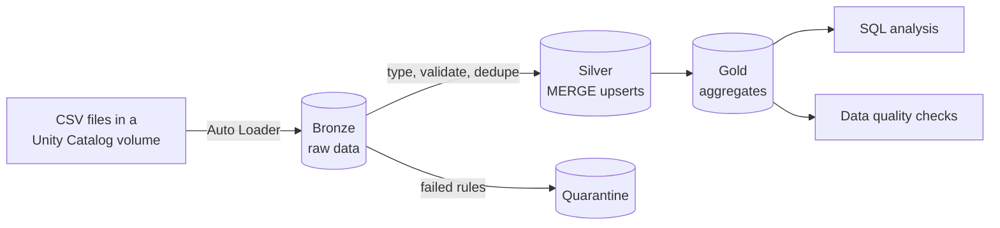

# Retail Sales Lakehouse on Databricks

An end-to-end data engineering mini project that processes retail order files through a
**Medallion Architecture** (Bronze, Silver, Gold) using PySpark, Delta Lake and Unity Catalog.
It is written for Azure Databricks serverless compute and Databricks Free Edition.

## Business problem
A retailer receives order files containing duplicates, invalid values and later status
updates. Analysts need trustworthy tables for revenue, product and customer reporting.

## Architecture



## Tech stack
Databricks, PySpark, Spark SQL, Delta Lake, Auto Loader, Unity Catalog, Lakeflow Jobs,
Declarative Automation Bundles, pytest, GitHub Actions.

## Features
- **Incremental ingestion:** Auto Loader with checkpoints and the `availableNow` trigger
- **Audit columns:** source file and ingestion time on every Bronze row
- **Data validation:** failed orders are quarantined with a rejection reason
- **Deduplication:** window function keeps the latest version of each order
- **Upserts:** Delta `MERGE` updates an order only when the incoming version is newer
- **Quality gate:** the pipeline fails on duplicates, invalid values or revenue mismatches
- **Orchestration as code:** a five-task job defined in YAML
- **Testing:** unit tests for the transformation logic, run by GitHub Actions

## Data model
| Layer | Table | Description |
|---|---|---|
| Bronze | `bronze_customers`, `bronze_products`, `bronze_orders` | Raw string data with audit columns |
| Silver | `silver_customers`, `silver_products` | Cleaned dimensions (SCD Type 1) |
| Silver | `silver_orders` | One current, valid row per order |
| Quarantine | `quarantine_orders` | Rejected rows with the reason |
| Gold | `gold_daily_sales` | Orders, units and revenue by date and category |
| Gold | `gold_product_performance` | Revenue and rank within category |
| Gold | `gold_customer_summary` | Lifetime value and last order date |

## Project structure
```
├── .github/workflows/ci.yml   # runs tests on each push
├── data/
│   ├── generate_data.py       # synthetic data generator
│   └── sample/                # generated CSV files
├── notebooks/                 # 00 setup to 04 quality checks
├── src/transformations.py     # reusable PySpark logic
├── tests/                     # pytest unit tests
├── sql/business_queries.sql   # reporting queries
├── resources/retail_job.yml   # job definition
├── docs/SETUP_GUIDE.md        # step-by-step instructions
├── databricks.yml             # bundle configuration
└── requirements-dev.txt
```

## How to run
See [docs/SETUP_GUIDE.md](docs/SETUP_GUIDE.md). In short:
1. Clone this repository into a Databricks Git folder.
2. Run notebooks `00` to `04` in order with `batch = 1`.
3. Run `00` again with `batch = 2`, then rerun `01` to `04`.

## Expected results
These counts follow from the sample data and pipeline rules.

| Table | After batch 1 | After batch 2 |
|---|---|---|
| `bronze_orders` | 515 | 658 |
| `silver_orders` | 500 | 600 |
| `quarantine_orders` | 10 | 13 |

Batch 1 contains 5 duplicate rows. Batch 2 contains 100 new orders, 40 status updates
from `PLACED` to `COMPLETED`, and 3 invalid rows.

## Run tests locally
Requires Python 3.11 and Java 17.
```bash
pip install -r requirements-dev.txt
pytest -v
```

## Limitations and future improvements
- Bronze is incremental, but Silver re-reads all of Bronze and Gold is fully rebuilt.
  Next step: process only changes using streaming or Delta Change Data Feed.
- Sales use the current product price. Next step: store the price on each order,
  or keep price history with SCD Type 2.
- Add Azure Data Lake Storage Gen2 through a Unity Catalog external location.
- Add an AI/BI dashboard and job failure alerts.

## Note
All data is synthetic. This is a learning and portfolio project.
